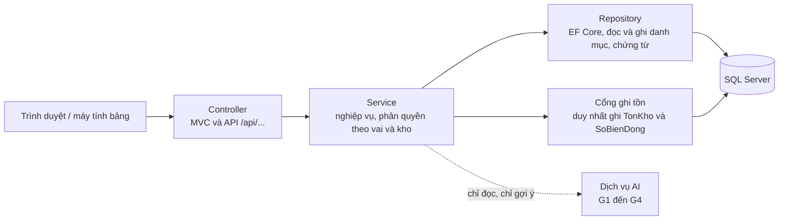

# QuanLyKhoThongMinh

Phần mềm quản lý **kho tổng nhiều kho** (2–3 kho, danh mục dùng chung) có **gợi ý bằng AI**, làm cho môn Đồ án.
Hàng được theo dõi 3 tầng **sản phẩm → biến thể → lô**; kho chia khu tiếp nhận, lưu trữ, cách ly, xuất; vị trí là cây 7 cấp (mã mẫu `K01-TA02-TG03-P04-H05-KE06-O07`).
AI chỉ **gợi ý** (lấy hàng G1, xếp hàng G2, nhập bổ sung G3, luân chuyển kho G4), không tự ghi tồn.

Công nghệ: ASP.NET Core MVC · Entity Framework Core · SQL Server.
Kế hoạch: Scrum, 6 sprint trong 7 tuần (báo cáo, mục 1.3, Bảng 1.8).

## Nhóm

| Thành viên | Vai trò | Phụ trách chính |
|---|---|---|
| TV1 – Nguyễn Văn Hiếu | Trưởng nhóm, BA, Scrum Master | Backlog, kiến trúc, phân quyền; duyệt mã và tích hợp |
| TV2 – Trần Tiến Đức | Backend 1 | CSDL danh mục và nhập kho; API danh mục vị trí, đơn mua, phiếu nhập |
| TV3 – Dương Tuấn Anh | Backend 2 | CSDL tồn kho; cổng ghi tồn, kiểm tra sức chứa, API xếp hàng |
| TV4 – Lê Đức Anh | Frontend 1, UI/UX | Design system, wireframe; màn hình đơn mua, phiếu nhập, quản lý vị trí |
| TV5 – Nguyễn Minh Hiếu | Frontend 2, QA | Màn hình xếp hàng; kế hoạch và ca kiểm thử |

## Cấu trúc thư mục

```
.
├── docs/       Tài liệu: kiến trúc (kien-truc.md), ERD, từ điển dữ liệu, wireframe, kế hoạch kiểm thử
├── database/   Script SQL Server, đánh số theo thứ tự chạy: 01_..., 02_..., 03_...
├── src/        Mã nguồn ASP.NET Core MVC (bố cục dự kiến ở docs/kien-truc.md, mục 5)
├── tests/      Unit test và test tích hợp
└── .github/    Mẫu Pull Request
```

## Quy ước Git

### Nhánh

| Nhánh | Dùng để | Quy tắc |
|---|---|---|
| `main` | Bản ổn định, dùng để demo và nộp | Được bảo vệ: không đẩy trực tiếp; chỉ gộp từ `develop` qua PR, cần ít nhất 1 người duyệt |
| `develop` | Nhánh tích hợp của sprint | Chỉ gộp từ nhánh `feature/...` qua PR |
| `feature/<mã việc>-<tên ngắn>` | Mỗi việc một nhánh | Tách từ `develop`; xóa sau khi gộp |

- `<mã việc>` lấy đúng theo Bảng 1.9 của báo cáo và Issue/GitHub Projects (ví dụ `S1-02`, `S2-04`; việc chia nhỏ thì thêm chữ như `S1-04a`).
- `<tên ngắn>`: chữ thường, không dấu, nối bằng dấu gạch ngang.
- Ví dụ: `feature/S1-02-cau-truc-repo`, `feature/S1-04a-vitri-tonkho`, `feature/S2-04-cong-ghi-ton`.

### Quy trình một việc

1. Nhận Issue (mã việc trùng mã ở Bảng 1.9), kiểm tra các việc phụ thuộc đã xong.
2. Tách nhánh từ `develop` mới nhất: `git checkout develop && git pull && git checkout -b feature/<mã việc>-<tên ngắn>`.
3. Commit nhỏ, đúng mẫu bên dưới. Đẩy nhánh lên GitHub.
4. Mở Pull Request **vào `develop`**, điền mẫu PR, gắn Issue (`Closes #<số>`).
5. **Một thành viên khác tác giả** duyệt mã (TV1 duyệt phần kiến trúc, phân quyền và tích hợp). Sửa theo góp ý, được duyệt rồi mới gộp.
6. Gộp bằng **Squash and merge** để mỗi việc là một commit trên `develop`; xóa nhánh feature.
7. Cuối sprint, TV1 mở PR `develop` → `main` sau buổi demo.

Không tự duyệt PR của chính mình. Không `force push` lên `main` và `develop`.

### Mẫu commit

```
<mã việc>: <mô tả ngắn bằng tiếng Việt không dấu, thể mệnh lệnh, dưới 72 ký tự>

(tùy chọn) Vì sao làm vậy, ảnh hưởng gì. Dẫn chiếu mục, bảng của báo cáo nếu có.
```

Ví dụ: `S1-04a: script SQL ViTri, TonKho, SoBienDong va du lieu thu`
Mỗi commit một thay đổi có ý nghĩa; không gộp việc khác mã vào cùng commit.

### Khi nào một việc được tính là xong

Theo báo cáo, mục 1.3: chạy đúng **tiêu chí chấp nhận**, có **unit test**, đã được **duyệt mã**, chạy được trên **dữ liệu thử**, đã **cập nhật tài liệu** (README hoặc `docs/`).

## Kiến trúc tóm tắt

ASP.NET Core MVC chia ba lớp, cộng một cổng ghi tồn:



Nguyên tắc cốt lõi:

- **Controller** chỉ nhận yêu cầu, kiểm tra dữ liệu vào, gọi Service, trả View hoặc JSON. Không chứa nghiệp vụ, không dùng `DbContext`.
- **Service** chứa nghiệp vụ (trạng thái chứng từ Bảng 2.14, kiểm tra sức chứa Bảng 2.33) và kiểm tra quyền theo vai và theo kho **ở máy chủ**.
- **Repository** chỉ truy cập dữ liệu bằng EF Core, không chứa nghiệp vụ.
- **Cổng ghi tồn** là nơi **duy nhất** được thêm, sửa `TonKho` và `SoBienDong`: một transaction, không cho tồn âm, chống ghi lặp bằng mã khóa. Mọi chức năng nhập, xếp, xuất, chuyển, kiểm kê đều gọi qua cổng này.
- **AI chỉ gợi ý**: không gọi cổng ghi tồn, không tự tạo hay duyệt phiếu; AI lỗi thì thao tác tay vẫn dùng được.

Chi tiết, luật ghi tồn và bố cục dự kiến của `src/`: xem [docs/kien-truc.md](docs/kien-truc.md).

## Quy ước API (báo cáo, mục 2.16.4, Bảng 2.35)

- REST, dữ liệu JSON; đường dẫn tiếng Việt không dấu, chữ thường, nối bằng gạch ngang: `/api/don-mua`, `/api/phieu-nhap/{ma}/xac-nhan`, `/api/vi-tri/cay`, `/api/xep-hang`.
- Mọi API kiểm tra quyền theo vai và theo kho ở máy chủ.
- API ghi tồn nhận mã chống ghi lặp ở header `Idempotency-Key`; gửi lại cùng mã không ghi lần hai.
- Lỗi nghiệp vụ trả mã **422** kèm lý do. Riêng lỗi xếp hàng kèm **số tối đa còn xếp được** để giao diện báo đúng.
- FE và BE thống nhất Bảng 2.35 trước khi code để làm song song; muốn đổi API phải sửa bảng đó và báo TV1.
