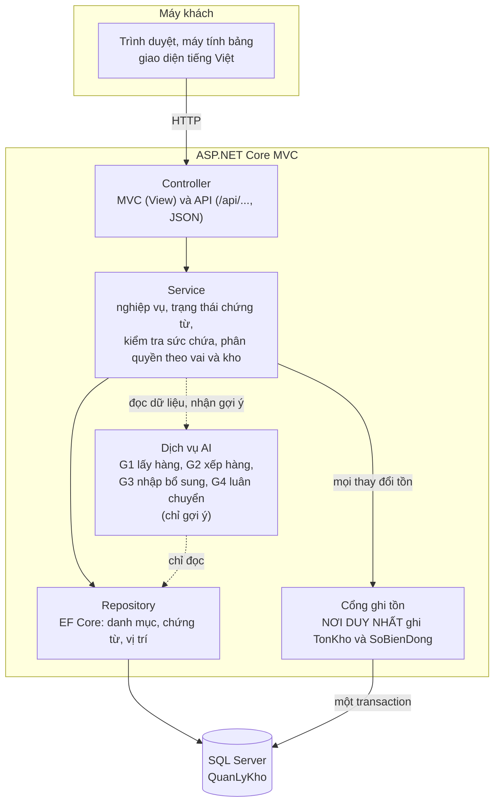
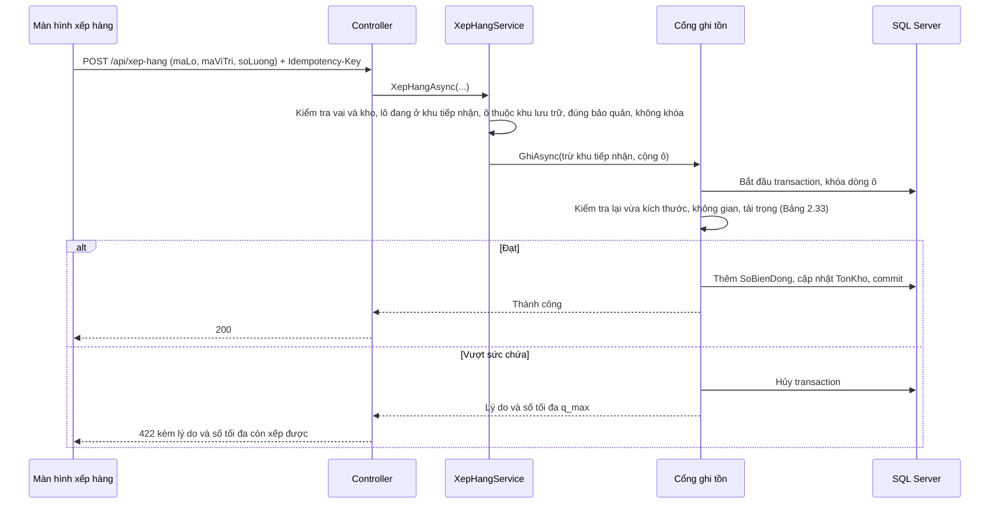

# Kiến trúc hệ thống (S1-02)

Tài liệu này mô tả kiến trúc ASP.NET Core MVC của hệ thống, gồm ba lớp **Controller, Service, Repository** và **cổng ghi tồn duy nhất**.
Nguồn: báo cáo mục 1.2.4 (Bảng 1.5), 1.3 (Bảng 1.9), 2.14 (Bảng 2.14), 2.16.3–2.16.4 (Bảng 2.33–2.35), yêu cầu phi chức năng NFR01–NFR03.

## 1. Sơ đồ tổng thể



Ảnh của sơ đồ này để chèn vào báo cáo: [so-do-kien-truc.png](so-do-kien-truc.png).

Đường nét đứt là đường **chỉ đọc**: dịch vụ AI không có đường ghi nào xuống cổng ghi tồn hay Repository ghi.

## 2. Trách nhiệm từng lớp

| Lớp | Làm | Không làm |
|---|---|---|
| **Controller** | Nhận yêu cầu, kiểm tra dữ liệu vào, gọi một Service, trả View hoặc JSON; đổi lỗi nghiệp vụ thành HTTP 422 | Không chứa nghiệp vụ; không dùng `DbContext`, không gọi Repository trực tiếp |
| **Service** | Quy tắc nghiệp vụ (trạng thái chứng từ Bảng 2.14, kiểm tra sức chứa Bảng 2.33, hạn dùng FEFO, người kiểm khác người lấy); kiểm tra quyền theo vai và theo kho; điều phối Repository và cổng ghi tồn | Không viết truy vấn EF Core; không tự ghi `TonKho`, `SoBienDong` |
| **Repository** | Đọc, ghi dữ liệu bằng EF Core cho danh mục, đơn mua, phiếu nhập, vị trí, người dùng; không xóa cứng dữ liệu đã có biến động tồn | Không chứa nghiệp vụ; không ghi `TonKho`, `SoBienDong` |
| **Cổng ghi tồn** | Ghi thay đổi tồn theo luật ở mục 3 | Không quyết định nghiệp vụ: Service kiểm tra trước, cổng kiểm tra lại các ràng buộc cứng |
| **Dịch vụ AI** | Đọc tồn, hạn dùng, vị trí; trả danh sách gợi ý kèm lý do | Không ghi tồn, không tạo hay duyệt phiếu |

Mỗi chức năng đi theo một chiều: Controller → Service → (Repository | cổng ghi tồn). Controller không gọi ngược lên, Repository không gọi Service.

## 3. Cổng ghi tồn duy nhất

Cơ sở: Bảng 1.5 dòng 1, NFR01. Mọi nhập, xếp hàng, xuất, chuyển kho, kiểm kê điều chỉnh đều đổi tồn **chỉ bằng cách gọi cổng này**.

**Luật của cổng**

1. **Một transaction**: ghi `SoBienDong` và cập nhật `TonKho` cùng một transaction; lỗi ở bất kỳ bước nào thì hủy toàn bộ.
2. **Không tồn âm**: `SoLuong >= 0` và `SoLuongDaGiu <= SoLuong` sau khi ghi; vi phạm thì hủy và trả lý do.
3. **Chống ghi lặp**: mỗi lần ghi mang một `MaKhoaChongLap` (lấy từ header `Idempotency-Key`), cột này không trùng trong `SoBienDong`. Gặp mã đã có thì trả kết quả lần trước, không ghi lần hai.
4. **Khóa dòng khi tranh chấp**: khóa dòng tồn và dòng ô liên quan, kiểm tra lại điều kiện rồi mới ghi, để hai người thao tác cùng lúc không làm vượt sức chứa hay tồn âm (Bảng 2.33 dòng 6).
5. **Chỉ ghi khi chứng từ Hoàn tất** (Bảng 2.14 dòng 5). Hủy chứng từ đã ghi bằng **bút toán đảo** trong `SoBienDong`, không sửa hay xóa dòng cũ.
6. **Sổ chỉ thêm**: `SoBienDong` không sửa, không xóa (NFR03). Đối chiếu bất biến: tổng `SoLuongThayDoi` theo lô, vị trí bằng `TonKho.SoLuong`.
7. **Tồn khả dụng** = `SoLuong − SoLuongDaGiu`, và **không** tính hàng ở khu tiếp nhận, khu cách ly, hàng đang vận chuyển giữa các kho (Bảng 1.5 dòng 4).
8. Số lượng dùng `decimal(14,3)`, không dùng số thực để tránh sai số làm tròn.

**Hợp đồng minh họa** (TV3 chốt chữ ký chính thức ở S2-04):

```csharp
public interface ITonKhoGateway
{
    // Thực hiện toàn bộ một chứng từ trong MỘT transaction.
    Task<KetQuaGhiTon> GhiAsync(YeuCauGhiTon yeuCau, CancellationToken huy = default);
}

public sealed record DongBienDong(
    string MaLo, string MaViTri, decimal SoLuongThayDoi);   // khác 0

public sealed record YeuCauGhiTon(
    string MaKhoaChongLap,                 // từ header Idempotency-Key
    string LoaiChungTu, string MaChungTu,  // PhieuNhap, XepHang, PhieuXuat, ...
    string NguoiThucHien,
    IReadOnlyList<DongBienDong> Dong);
```

**Cách giữ "duy nhất" trong thực tế**

- Chỉ `TonKhoGateway` được tham chiếu `DbSet<TonKho>` và `DbSet<SoBienDong>` để **ghi**; Repository khác chỉ có phương thức đọc cho hai bảng này.
- Có một test kiến trúc trong `tests/` (làm cùng S2-04) báo lỗi khi lớp khác ngoài cổng gọi ghi vào hai bảng đó.
- Người duyệt PR kiểm tra mục "Nếu đụng tồn kho" trong mẫu PR.

## 4. Phân quyền

Cơ sở: NFR02, Bảng 1.5 dòng 3 và dòng 10, mục 2.11. Bốn vai: **quản trị viên, quản lý kho, thủ kho, nhân viên bán hàng**.

- Kiểm tra **ở máy chủ**, hai tầng: (1) thuộc tính phân quyền theo vai ở Controller; (2) Service kiểm tra người dùng được gán **kho** của chứng từ. Ẩn nút trên giao diện không thay cho hai tầng này.
- Tài khoản bị khóa mất quyền ngay (kiểm tra mỗi yêu cầu, không chỉ lúc đăng nhập).
- Thao tác quan trọng ghi nhật ký chỉ thêm (NFR03).
- Việc xây dựng đăng nhập và phân quyền là S2-01 (TV1), phụ thuộc S1-02 này.

## 5. Bố cục `src/` dự kiến

Chưa tạo dự án rỗng ở S1-02; tạo khi bắt đầu code ở Sprint 2 theo bố cục sau để mọi người dùng chung một khung.

```
src/
├── QuanLyKho.Web/              ASP.NET Core MVC
│   ├── Controllers/            MVC controller (View)
│   ├── Controllers/Api/        API controller (/api/...)
│   ├── Views/                  Razor, tiếng Việt
│   └── wwwroot/
├── QuanLyKho.Application/      Service, mô hình yêu cầu/kết quả, giao diện Repository
│   ├── Services/
│   ├── Ai/                     G1 đến G4, chỉ gợi ý
│   └── Abstractions/
└── QuanLyKho.Data/             EF Core
    ├── Entities/               khớp Hình 2.11 và Bảng 2.34
    ├── QuanLyKhoDbContext.cs
    ├── Repositories/
    └── Stock/TonKhoGateway.cs  cổng ghi tồn duy nhất

tests/
└── QuanLyKho.Tests/            unit test và test kiến trúc
```

Phụ thuộc giữa dự án: `Web → Application → Data`. Không có chiều ngược lại.

## 6. Ví dụ luồng: xếp hàng `POST /api/xep-hang`



## 7. Việc phụ thuộc vào tài liệu này

| Mã việc | Nội dung | Dùng gì ở đây |
|---|---|---|
| S2-01 | Đăng nhập, phân quyền theo vai và kho | Mục 4 |
| S2-04 | Cổng ghi tồn | Mục 3 |
| S3-02 | Dịch vụ kiểm tra sức chứa, API xếp hàng | Mục 2, 3, 6 |
| Mọi việc | Tên nhánh, commit, PR | README, mục "Quy ước Git" |
